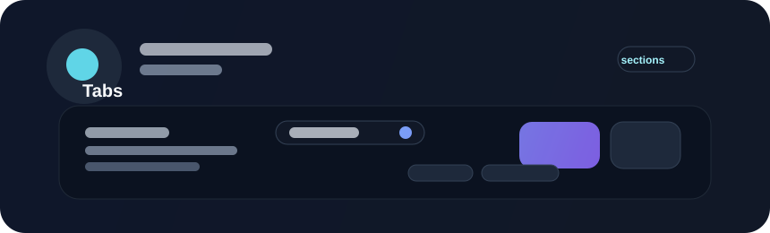

# Tabs

## Live Demo

<iframe src="../assets/demos/index.html?demo=tabs" title="Interactive Beverly tabs demo" loading="lazy" allow="fullscreen" style="display: block; width: 100%; height: min(820px, 90vh); min-height: 580px; border: 0;"></iframe>

<a href="../assets/demos/index.html?demo=tabs" target="_blank" rel="noopener">Open the demo in a separate tab</a>.



Tabs organize several related views within the same area. They are useful for settings, dashboards, or content sections that share a common context and need to switch without leaving the parent surface.

## Example

```rust
use beverly::prelude::*;
use beverly::components::tabs::TabsConfig;

app().children([
    UiElement::tabs(TabsConfig::new(vec![
        Tab::new("overview", "Overview"),
        Tab::new("activity", "Activity"),
    ]))
    .header(text("Workspace"))
    .body(text("Panel content"))
    .footer(button().text("Refresh")),
]).run();
```

## Header, Body, and Footer

`.header(...)`, `.body(...)`, and `.footer(...)` create top, middle, and bottom
regions inside each tab's content zone, below the tab navigation bar. Each
accepts one element or an iterable; repeated calls append, and section order
does not depend on call order. Ordinary `.children(...)` content joins the
body before explicit body content. The body grows into available panel height.

The fluent builder supplies the same section content to every tab. For content
that differs per tab, use `spawn_tabs(...)` or `spawn_tabs_in(...)` and build
each zone with the callback's tab index or definition. `ContentSection` markers
identify the fluent section entities. Existing tab selection, transitions, and
keyboard navigation are unchanged.

## Guidance

- use tabs for local navigation, not global app navigation
- keep the number of tabs manageable
- ensure the active tab is visually and semantically clear
- support arrow-key navigation when possible
- keep the content behind the tabs consistent with the selected panel

## Accessibility

Tabs should provide a visible selected state, a clear focus order, and labels that make sense independently. Users should be able to understand which panel is active without relying only on color or hover styling.
